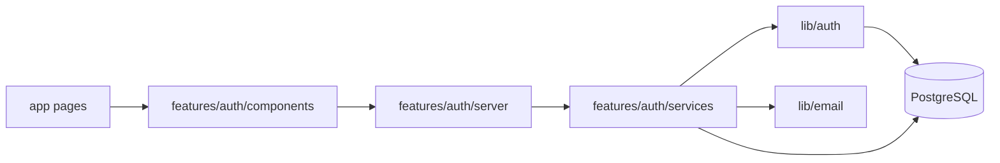

# Authentication (Phase 1)

Phase 1 adds custom authentication with Argon2id passwords, database-backed sessions, email verification, password reset, optional TOTP, and recovery codes.

## Architecture

- **Pages** (`app/(auth)`, `app/(protected)`, `app/verify-email`) are thin RSC wrappers.
- **Server Actions** in `features/auth/server/` are thin wrappers (IP resolution, redirects).
- **Business logic** lives in `features/auth/services/` (unit-tested).
- **Crypto and session primitives** live in `lib/auth/`.
- **Email** is sent through the `EmailProvider` interface (`lib/email/`).

## Database tables

| Table | Purpose |
|-------|---------|
| `users` | Account record (`email`, `passwordHash`, `emailVerified`) |
| `sessions` | Active login sessions (`userId`, `expiresAt`) |
| `pending_logins` | Server-side TOTP challenge state during login |
| `email_verification_tokens` | Hashed single-use email verification tokens |
| `password_reset_tokens` | Hashed single-use password reset tokens |
| `totp_settings` | Encrypted TOTP secret (`secretEncrypted`, `enabled`) |
| `recovery_codes` | Argon2id-hashed single-use recovery codes |

All child tables use `ON DELETE CASCADE` from `users`.

## Session flow

1. User submits valid credentials (email must be verified).
2. If TOTP is disabled: `rotateSession()` creates a new session row, sets HTTP-only signed cookie.
3. If TOTP is enabled: a `pending_logins` row is created; cookie holds only the pending login ID.
4. After TOTP/recovery code verification: session is rotated, pending row deleted.
5. `getSession()` validates expiry on every authoritative check.
6. Logout deletes the session row and clears cookies.

Cookie attributes:

- `httpOnly`, `sameSite=lax`, `path=/`
- `secure` when `APP_ENV !== local`
- `__Host-` prefix in non-local environments
- Value is `sessionId.HMAC-SHA256` using `SESSION_SECRET` (middleware validates signature)

- Client IP for rate limits uses `X-Forwarded-For` / `X-Real-IP` only when `TRUST_PROXY_HEADERS=true` and the direct peer (`x-connecting-peer`) is listed in `TRUSTED_PROXY_CIDRS`; otherwise a hashed fingerprint is used.
- Your reverse proxy must set `x-connecting-peer` to the TCP peer IP of the app connection. Bind the Node process to localhost so only the proxy can reach it.
- Stale signed session cookies are cleared when the DB session is missing (`getAuthSession` clears session cookies only, preserving pending-login cookies during TOTP).
- Guest routes no longer redirect purely on cookie signature; login page redirects when a live session exists.
- Invalid signed cookies are cleared on guest routes by middleware (session and pending-login separately).
- Unverified users can resend verification email from the login page without signing in.
- Production reads `__Host-*` cookies before legacy names; setting a session clears the alternate cookie name.
- Re-registering an existing unverified email returns a generic message without changing the password (use guest resend on login).
- Enabling or disabling TOTP reissues the session and invalidates all other sessions.
- Recovery-code regeneration requires password and TOTP.
- Starting TOTP login clears any existing session cookie.

## Email verification

1. Register or resend creates a random token; only SHA-256 hash stored in DB.
2. Email contains link to `/verify-email?token=...`.
3. Client page POSTs token via Server Action (no GET mutation).
4. On success: `emailVerified = true`, token row deleted.

## Password reset

1. Request always returns a generic success message.
2. Prior reset tokens for the user are deleted before issuing a new one.
3. Reset link POSTs token + new password.
4. On success: password updated, token deleted, all sessions invalidated.

## TOTP flow

**Enrollment**

1. `beginTotpSetup` stores encrypted secret with `enabled = false`.
2. User scans QR code and submits first TOTP code.
3. `confirmTotpSetup` verifies code, sets `enabled = true`, generates 10 recovery codes (64-bit hex each, shown once).

**Login**

1. Password step creates `pending_logins` row.
2. User submits TOTP or recovery code.
3. Max 5 attempts per pending login; then forced full re-login.

**Disable / regen**

- Disable requires password + TOTP or recovery code.
- Recovery code regeneration requires valid TOTP and replaces all unused codes in a transaction.

TOTP verification uses a ±1 step window (30 seconds).

## Rate limiting

In-memory per-process limits in `lib/security/auth-rate-limit.ts` for local development. Production requires `REDIS_URL` for shared limits across instances.

- Login: IP + email (10 / 15 min)
- TOTP: pending ID + IP + user (5 / 5 min)
- Signup, reset, verify, resend, TOTP setup/disable, recovery regen: dedicated presets
- Bucket eviction prefers non-`auth:` keys when the in-memory map is full

## Environment variables

| Variable | Purpose |
|----------|---------|
| `SESSION_SECRET` | HMAC signing for session cookies (min 32 chars) |
| `REDIS_URL` | Redis connection URL (required when `APP_ENV=prod`) |
| `TRUST_PROXY_HEADERS` | When `true`, trust `X-Forwarded-For` only when `x-connecting-peer` is in `TRUSTED_PROXY_CIDRS` |
| `TRUSTED_PROXY_CIDRS` | Comma-separated IPv4 CIDRs for trusted reverse proxies (must match `x-connecting-peer`) |
| `ENCRYPTION_KEY` | TOTP secret encryption at rest (min 32 chars) |
| `EMAIL_PROVIDER` | `console` (default) or future providers |

## Security decisions

- Argon2id with pinned params (64 MB, 3 iterations, parallelism 1)
- Dummy hash verification when user not found (timing-safe login)
- Uniform login error message
- Email normalization (lowercase + trim)
- Session rotation on every login
- SHA-256 hashed tokens at rest with constant-time compare
- Separate `ENCRYPTION_KEY` for TOTP secrets
- Server-side `pending_logins` for TOTP challenge
- `getSession()` required in all mutating authenticated actions

## Known Phase 1 limitations

- No Content-Security-Policy yet (Phase 9)
- No permanent account lockout beyond rate limits
- No logged-in password change flow
- Console email provider logs full body only in `APP_ENV=local`

## Future extension points

- `ResendProvider` implementing `EmailProvider`
- Redis-backed rate limiting for horizontal scale
- Background job for expired session/token purge
